# agentic-pipeline-builder: demo video audit report

**Repository:** https://github.com/kavya2693/agentic-pipeline-builder  
**Numbers taken from commit:** `cbcb816` (outputs last changed in `cbcb816 (2026-10-13 22:10:14 +0400)`)  
**Video:** `docs/demo/demo.mp4` (88.4 s, 1920x1080, 30 fps, silent)  
**Generated:** 2026-10-14 18:36  
**Automated checks:** 61 pass · 0 fail · 1 manual (of 62 figures)

## How to use this report

Every number or claim on screen has an ID (`F-01`, `F-02`, ...) and every modelling assumption has an ID (`A-01`, ...). Cite the ID. Each figure lists its source file, the exact column/row/key, the formula for derived numbers, and an automated check result. The change-impact matrix tells you which slides and files change if an input or assumption changes.

Types: **direct** = read straight from a repo output; **derived** = computed from direct values (formula given); **illustrative** = drawing or example, not data; **general knowledge** = context not produced by the repo.

### Regenerate

```bash
make e2e                                   # data/raw + answer key, then discover, validate, build, dbt build, score -> outputs/metrics.json, report.md
make stress                                # outputs/stress.json, stress.md (10%-scale defect-rate sweep)
PYTHONPATH=src .venv/bin/python docs/demo/source/tools/export_contract_sheet.py docs/demo/source/assets/contract_sheet.json
python3 docs/demo/source/tools/inject_contract.py docs/demo/source/assets/contract_sheet.json docs/demo/source/compositions/value.html --rules orders__pk__unique,orders__customer_id__not_null,orders__customer_id__references_customers,orders__ordered_at__window,orders__order_total__type,orders__status__in_set
cd docs/demo/source && npx --yes hyperframes@0.8.156 check && npx --yes hyperframes@0.8.156 render -f 30 -q looks -o renders/agentic-pipeline-builder-master.mp4 && cd -
ffmpeg -y -i docs/demo/source/renders/agentic-pipeline-builder-master.mp4 -c:v libx264 -preset slow -crf 25 -pix_fmt yuv420p -movflags +faststart -an docs/demo/demo.mp4
python3 docs/demo/source/tools/build_audit_report.py docs/demo/source/audit/facts.yaml   # stills, checks, MD/DOCX/PDF
```

## 1. Figures

| ID | Shown on screen | Slides | Source | Column / row / key | How computed | Type | Check |
|---|---|---|---|---|---|---|---|
| F-01 | 3 chips | 01 | `author's framing` | - | - | general knowledge | manual: Context statement, not a repo output. |
| F-02 | 4 problem cards | 01 | `README 'The problem', 'Why it is hard'` | README lines 16-34 | - | general knowledge | ✓ verified |
| F-03 | 7 files | 02, 05, 08 | `examples/catalog.yml` | tables | count of tables | direct | ✓ verified |
| F-04 | 1.86M rows | 02, 05, 06, 08 | `outputs/metrics.json` | quarantine[*].rows | 60,300 + 972,645 + 402,000 + 405,134 + 4,000 + 19,575 + 120 = 1,863,774 | derived | ✓ verified |
| F-05 | 45,677 planted defects | 02, 06, 08 | `outputs/metrics.json` | dq.agent.injected | - | direct | ✓ verified |
| F-06 | csv · json · jsonl · parquet | 02 | `examples/catalog.yml` | tables[*].file extensions | set of extensions | direct | ✓ verified |
| F-07 | two date formats in one column | 02 | `examples/catalog.yml` | customers.signup_date formats ['%m/%d/%Y', '%Y-%m-%d'] | - | direct | ✓ verified |
| F-08 | 9 defect types at known rows | 02 | `outputs/metrics.json` | dq.agent.by_defect | count of keys | direct | ✓ verified |
| F-09 | ONE STATE MACHINE / orchestrator.py band | 03, 05 | `src/pipeline_builder/orchestrator.py:131-148` | STATES, TRANSITIONS | - | direct | ✓ verified |
| F-10 | too many bad rows? stop / quarantine > 5%? any table / HALTED | 03, 05 | `src/pipeline_builder/orchestrator.py:35, :93-95, :143` | max_quarantine_rate = 0.05; too_many_rejects -> HALTED | - | direct | ✓ verified |
| F-11 | build, test, retry once / retried once | 03, 05 | `src/pipeline_builder/orchestrator.py:153` | MAX_ATTEMPTS DBT_BUILD = 2 | 2 attempts = 1 retry | direct | ✓ verified |
| F-12 | every type right / bad rows caught / dbt build green | 03 | `outputs/metrics.json` | schema.types.agent, quarantine, dbt | agent types correct == total; quarantined rows > 0; dbt.ok and no failed tests | derived | ✓ verified |
| F-13 | 93.0% | 04, 09 | `outputs/stress.json` | sweep['0.005'].dq_recall | - | direct | ✓ verified |
| F-14 | 20.8% | 04, 09 | `outputs/stress.json` | sweep['0.02'].dq_recall | - | direct | ✓ verified |
| F-15 | 92.0% | 04, 09 | `outputs/stress.json` | frozen_contract['0.005'].dq_recall | - | direct | ✓ verified |
| F-16 | 91.3% (slide 09 panel and payoff strip) | 04, 09 | `outputs/stress.json` | frozen_contract['0.02'].dq_recall | - | direct | ✓ verified |
| F-17 | red bar 0.9300 -> 0.2075, green bar 0.9197 -> 0.9126 of full width | 04 | `demo:compositions/explainer.html; outputs/stress.json` | scaleX targets | scaleX = recall (4 decimals, as stored) | derived | ✓ verified |
| F-18 | 39 s · 44 s · 0.14 s · 6 s · 11 s | 05 | `outputs/metrics.json` | state_log[*].seconds (DISCOVER..DBT_BUILD) | 38.67, 44.15, 0.14, 5.93, 10.99 rounded (BUILD kept to 2 decimals) | derived | ✓ verified |
| F-19 | 100 s (slides 05, 06 title, 08) / 99.9 s (slide 06 log) | 05, 06, 08 | `outputs/metrics.json` | seconds_raw_to_built = 99.9 | rounded to whole seconds | direct | ✓ verified |
| F-20 | 136 rules | 05, 06 | `outputs/metrics.json; examples/rules.yml` | rules | - | direct | ✓ verified |
| F-21 | 39 files / 39 dbt files | 05, 06 | `outputs/metrics.json` | generated.dbt_files | - | direct | ✓ verified |
| F-22 | DAG · nightly 03:00 | 05 | `examples/raw_drop_pipeline.py:25` | schedule='0 3 * * *' | - | direct | ✓ verified |
| F-23 | 31 models | 05, 06, 08 | `outputs/metrics.json` | dbt.models.success | - | direct | ✓ verified |
| F-24 | 91 tests pass | 05, 06, 08 | `outputs/metrics.json` | dbt.tests.pass | - | direct | ✓ verified |
| F-25 | file tags on the boxes | 05 | `src/pipeline_builder/*.py; README` | orchestrator, discovery, validation, describe, builder, sql, runtime, dbt_run, evaluate | - | direct | ✓ verified |
| F-26 | --contract into Discover and Validate | 05 | `src/pipeline_builder/orchestrator.py:69-90` | cfg.contract -> catalog.yml, rules.yml | - | direct | ✓ verified |
| F-27 | row-for-row check | 05, 06 | `outputs/metrics.json` | sql_vs_pandas[*].only_sql, only_pandas | all zero | direct | ✓ verified |
| F-28 | Local LLM · opt-in · wording only | 05 | `src/pipeline_builder/describe.py:1-7, :24-27; cli.py:203` | ollama_client, --llm default None | - | direct | ✓ verified |
| F-29 | 54 columns · 7 keys · 7 joins | 06 | `outputs/metrics.json` | schema.types.agent.total, primary_keys.correct, foreign_keys.found | - | direct | ✓ verified |
| F-30 | 38.67 · 44.15 · 0.14 · 5.93 · 10.99 | 06 | `outputs/metrics.json` | state_log[*].seconds | - | direct | ✓ verified |
| F-31 | 88-line DAG | 06 | `outputs/metrics.json` | generated.dag_lines | - | direct | ✓ verified |
| F-32 | 5 warn | 06 | `outputs/metrics.json` | dbt.tests.warn | - | direct | ✓ verified |
| F-33 | DONE · 0 tests failed | 06 | `outputs/metrics.json` | final_state, dbt.failed | - | direct | ✓ verified |
| F-34 | orders 2.86% 11,507 · order_items 2.00% 19,452 · customers 1.99% 1,200 · payments 1.83% 7,409 · returns 0.50% 98 · products 0.00% 0 · stores 0.00% 0 | 06 | `outputs/metrics.json` | quarantine[*] | quarantine_rate x 100 to 2 decimals | direct | ✓ verified |
| F-35 | the same 39,666 rows | 06, 08 | `outputs/metrics.json` | sql_vs_pandas[*].both | 1,200 + 19,452 + 11,507 + 7,409 + 98 = 39,666 (sql = pandas = both) | derived | ✓ verified |
| F-36 | 9 bars with plain names | 06 | `outputs/metrics.json; src/pipeline_builder/datagen.py:515-569` | dq.agent.by_defect | on-screen names: duplicate_row = Duplicate row, null_required = Missing required value, orphan_fk = ID with no match, type_corruption = Text in a number field, negative_value = Negative amount, future_date = Date in the future, malformed_email = Broken email, invalid_enum = Status or method typo (orders.status, payments.method), outlier_value = Price inflated 100x (order_items.unit_price x 100) | direct | ✓ verified |
| F-37 | 88.6% | 06, 08 | `outputs/metrics.json` | dq.agent.recall = 0.8856 | - | direct | ✓ verified |
| F-38 | 100% for Duplicate row and Missing required value, 0% for the other seven | 06 | `outputs/metrics.json` | dq.naive_baseline.by_defect | - | direct | ✓ verified |
| F-39 | order_id unique 2,000 · customer_id not null 2,000 · customer_id in customers 2,000 · ordered_at date in window 2,000 · order_total is decimal 2,000 · status one of 7 values 1,515 | 07 | `demo:assets/contract_sheet.json (tools/export_contract_sheet.py re-runs discovery + validation on data/raw); examples/rules.yml` | rules[*].rows_flagged, evidence, severity | rows held per rule = unique rows the rule flags | derived | ✓ verified |
| F-40 | 11,507 of 402,000 rows held back (2.86%) | 07 | `outputs/metrics.json` | quarantine[table=orders] | 11,507 / 402,000 = 2.86% | direct | ✓ verified |
| F-41 | stg_orders 390,493 | 07 | `outputs/metrics.json` | orders rows - quarantined; marts.fct_orders | 402,000 - 11,507 = 390,493 (equals the fct_orders row count) | derived | ✓ verified |
| F-42 | + 17 more rules on orders (16 flag no rows) | 07 | `examples/rules.yml; demo:assets/contract_sheet.json` | orders rules = 23 | 23 - 6 shown = 17; 16 of them flag 0 rows (the order_total outlier warning flags 17) | derived | ✓ verified |
| F-43 | cancel, pending_x ringed in the status value set | 07 | `examples/rules.yml orders__status__in_set; README 'Known limitations'` | kwargs.value_set | - | direct | ✓ verified |
| F-44 | under the 5% gate | 06, 07 | `outputs/metrics.json` | max quarantine_rate = 0.02862 | max rate < 0.05 | derived | ✓ verified |
| F-45 | Days of detective work become a review. | 07 | `README 'The problem' (days per source) and 'Known limitations' (first contract needs a person)` | - | - | general knowledge | ✓ verified |
| F-47 | 100% (54/54) | 08, 03 | `outputs/metrics.json` | schema.types.agent.accuracy | - | direct | ✓ verified |
| F-48 | plain pandas read: 68.5% / plain DuckDB read: 81.5% | 08 | `outputs/metrics.json` | schema.types.pandas_default / duckdb_sniff accuracy | - | direct | ✓ verified |
| F-50 | hand-written checks / catch 29.5% | 08 | `outputs/metrics.json` | dq.naive_baseline.recall | - | direct | ✓ verified |
| F-51 | 98.4% | 08 | `outputs/metrics.json` | dq.agent.row_precision | - | direct | ✓ verified |
| F-52 | hand-written checks / precision 3.4% | 08 | `outputs/metrics.json` | dq.naive_baseline.row_precision | - | direct | ✓ verified |
| F-58 | 16.3% | 09 | `outputs/stress.json` | sweep['0.1'].dq_recall | - | direct | ✓ verified |
| F-59 | 91.5% | 09 | `outputs/stress.json` | frozen_contract['0.1'].dq_recall | - | direct | ✓ verified |
| F-60 | 2% dirty · 4 of 7 keys found | 09 | `outputs/stress.json` | sweep['0.02'].primary_keys | - | direct | ✓ verified |
| F-61 | Every learned limit sits near 1%, so past it the check is never written, and nothing warns. | 09 | `src/pipeline_builder/discovery.py:30-31; validation.py:25, :31` | KEY_MAX_NULL 0.01, KEY_MIN_DISTINCT 0.99, NOT_NULL_MAX 0.01, NON_NEGATIVE_SHARE 0.99 | - | direct | ✓ verified |
| F-67 | Enforce last month's signed rules / run with --contract / The run loads the signed rules.yml instead of re-learning it, and a test pins this. | 09 | `src/pipeline_builder/orchestrator.py:39-41, :69-90; cli.py:206; tests/test_pipeline.py:125-142` | RunConfig.contract; discover_state, validate_state; test_frozen_contract_still_catches_defects_on_a_much_dirtier_drop | - | direct | ✓ verified |
| F-68 | 242 · 54 · 42 · 239 · 237 · 238 px | 09 | `demo:compositions/s06-twist.html; outputs/stress.json` | #twist-lb1..3, #twist-rb1..3 widths | round(recall x 260) | derived | ✓ verified |
| F-69 | 0.5% to 10% of rows carry each defect; rows 0.5% · 2% · 10% dirty | 09 | `outputs/stress.json` | sweep keys, frozen_contract keys | - | direct | ✓ verified |
| F-70 | make stress reruns the lesson on slide 09 | 10 | `Makefile` | stress: scripts/stress_defect_rate.py | - | direct | ✓ verified |
| F-63 | OPEN SOURCE · MIT | 10 | `LICENSE` | - | - | direct | ✓ verified |
| F-64 | dbt · DuckDB · Airflow DAG · pandas · Python | 10 | `pyproject.toml; examples/raw_drop_pipeline.py` | dependencies; airflow import | - | direct | ✓ verified |
| F-65 | $ make e2e   # generate 1.86M rows, build, dbt build, score | 10 | `Makefile` | e2e: data run | - | direct | ✓ verified |
| F-66 | RUNS ON A LAPTOP | 10 | `README 'The result'` | 'green build in 100 s on a laptop' | - | direct | ✓ verified |

## 2. Automated check run (2026-10-14 18:36)

| ID | Expected on slide | Recomputed from repo | Result |
|---|---|---|---|
| F-01 | 3 chips | - | manual |
| F-02 | true | true | ✓ pass |
| F-03 | 7 | 7 | ✓ pass |
| F-04 | 1.86M | 1.86M | ✓ pass |
| F-05 | 45,677 | 45,677 | ✓ pass |
| F-06 | csv · json · jsonl · parquet | csv · json · jsonl · parquet | ✓ pass |
| F-07 | 2 | 2 | ✓ pass |
| F-08 | 9 | 9 | ✓ pass |
| F-09 | true | true | ✓ pass |
| F-10 | true | true | ✓ pass |
| F-11 | true | true | ✓ pass |
| F-12 | true | true | ✓ pass |
| F-13 | 93.0% | 93.0% | ✓ pass |
| F-14 | 20.8% | 20.8% | ✓ pass |
| F-15 | 92.0% | 92.0% | ✓ pass |
| F-16 | 91.3% | 91.3% | ✓ pass |
| F-17 | true | true | ✓ pass |
| F-18 | 39 s · 44 s · 0.14 s · 6 s · 11 s | 39 s · 44 s · 0.14 s · 6 s · 11 s | ✓ pass |
| F-19 | 100 s | 100 s | ✓ pass |
| F-20 | 136 | 136 | ✓ pass |
| F-21 | 39 | 39 | ✓ pass |
| F-22 | true | true | ✓ pass |
| F-23 | 31 | 31 | ✓ pass |
| F-24 | 91 | 91 | ✓ pass |
| F-25 | true | true | ✓ pass |
| F-26 | true | true | ✓ pass |
| F-27 | true | true | ✓ pass |
| F-28 | true | true | ✓ pass |
| F-29 | 54 columns · 7 keys · 7 joins | 54 columns · 7 keys · 7 joins | ✓ pass |
| F-30 | 38.67 · 44.15 · 0.14 · 5.93 · 10.99 | 38.67 · 44.15 · 0.14 · 5.93 · 10.99 | ✓ pass |
| F-31 | 88 | 88 | ✓ pass |
| F-32 | 5 | 5 | ✓ pass |
| F-33 | DONE · 0 failed | DONE · 0 failed | ✓ pass |
| F-34 | orders 2.86% 11,507 · order_items 2.00% 19,452 · customers 1.99% 1,200 · payments 1.83% 7,409 · returns 0.50% 98 · products 0.00% 0 · stores 0.00% 0 | orders 2.86% 11,507 · order_items 2.00% 19,452 · customers 1.99% 1,200 · payments 1.83% 7,409 · returns 0.50% 98 · products 0.00% 0 · stores 0.00% 0 | ✓ pass |
| F-35 | 39,666 | 39,666 | ✓ pass |
| F-36 | duplicate_row 4,316 100.0% · null_required 9,179 100.0% · orphan_fk 6,961 100.0% · type_corruption 6,863 100.0% · negative_value 6,879 100.0% · future_date 2,300 100.0% · malformed_email 300 100.0% · invalid_enum 4,016 63.4% · outlier_value 4,863 22.8% | duplicate_row 4,316 100.0% · null_required 9,179 100.0% · orphan_fk 6,961 100.0% · type_corruption 6,863 100.0% · negative_value 6,879 100.0% · future_date 2,300 100.0% · malformed_email 300 100.0% · invalid_enum 4,016 63.4% · outlier_value 4,863 22.8% | ✓ pass |
| F-37 | 88.6% | 88.6% | ✓ pass |
| F-38 | true | true | ✓ pass |
| F-39 | true | true | ✓ pass |
| F-40 | 11,507 of 402,000 (2.86%) | 11,507 of 402,000 (2.86%) | ✓ pass |
| F-41 | 390,493 | 390,493 | ✓ pass |
| F-42 | 17 more (16 flag no rows) | 17 more (16 flag no rows) | ✓ pass |
| F-43 | true | true | ✓ pass |
| F-44 | true | true | ✓ pass |
| F-45 | true | true | ✓ pass |
| F-47 | 100% | 100% | ✓ pass |
| F-48 | pandas 68.5% · DuckDB 81.5% | pandas 68.5% · DuckDB 81.5% | ✓ pass |
| F-50 | 29.5% | 29.5% | ✓ pass |
| F-51 | 98.4% | 98.4% | ✓ pass |
| F-52 | 3.4% | 3.4% | ✓ pass |
| F-58 | 16.3% | 16.3% | ✓ pass |
| F-59 | 91.5% | 91.5% | ✓ pass |
| F-60 | 4/7 | 4/7 | ✓ pass |
| F-61 | true | true | ✓ pass |
| F-67 | true | true | ✓ pass |
| F-68 | true | true | ✓ pass |
| F-69 | 0.5% to 10% | 0.5% to 10% | ✓ pass |
| F-70 | true | true | ✓ pass |
| F-63 | true | true | ✓ pass |
| F-64 | true | true | ✓ pass |
| F-65 | true | true | ✓ pass |
| F-66 | true | true | ✓ pass |

## 3. Assumptions register

| ID | Assumption | Source | Used by | Sensitivity: if this changes |
|---|---|---|---|---|
| A-01 | All data is synthetic: a seeded generator writes a regional retailer's nightly drop (60k customers, 400k orders, 973k order lines, 405k payments, 20k returns, 4,000 products, 120 stores). The generator and the inference rules were written by the same person, so 100% type accuracy is an upper bound, not evidence that the rules generalise. | `scripts/generate_data.py:14-18 (scale 1.0, seed 7); src/pipeline_builder/datagen.py; README 'The data'` | all figures | figures all figures and slides 01, 02, 03, 04, 05, 06, 07, 08, 09, 10 change |
| A-02 | Defects are planted at 0.5% of rows per defect type (nine types) at known rows; the answer key in data/ground_truth holds every type, key, relationship and defect. | `scripts/generate_data.py:15 (--defect-rate 0.005); README 'The data'` | F-05, F-08, F-36, F-37, F-38, F-50, F-51, F-52 | figures F-05, F-08, F-36, F-37, F-38, F-50, F-51, F-52 and slides 02, 06, 08 change |
| A-03 | The drop is judged as of 2026-02-01: date-window rules reject dates after the run date. | `Makefile:4 (AS_OF ?= 2026-02-01); validation.py (date window rule)` | F-34, F-36, F-39, F-40 | figures F-34, F-36, F-39, F-40 and slides 06, 07 change |
| A-04 | Quarantine gate: the run halts before building if any table would quarantine more than 5% of its rows. | `src/pipeline_builder/orchestrator.py:35 (max_quarantine_rate = 0.05), :143 (too_many_rejects -> HALTED); cli.py:201` | F-10, F-34, F-44 | figures F-10, F-34, F-44 and slides 03, 05, 06, 07 change |
| A-05 | Profiler tolerances sit near 1%: a type needs 98% of values to parse, a required column at most 1% nulls, a key 99% distinct and at most 1% nulls, a non-negative column 99% non-negative, a category at least 0.1% of rows; outliers are flagged above 10x the p99. | `src/pipeline_builder/discovery.py:27, :30-31, :33; validation.py:25, :28, :31, :33` | F-03, F-20, F-29, F-36, F-47, F-13, F-14, F-58, F-61 | figures F-03, F-20, F-29, F-36, F-47, F-13, F-14, F-58, F-61 and slides 02, 03, 04, 05, 06, 08, 09 change |
| A-06 | Retry policy: only DBT_BUILD and LAND are retried (2 attempts each); a rule that fails on the data fails the same way twice. | `src/pipeline_builder/orchestrator.py:153 (MAX_ATTEMPTS)` | F-11 | figures F-11 and slides 03, 05 change |
| A-07 | Timings are wall-clock seconds from one run on the author's laptop and vary with the machine and its load. | `outputs/metrics.json state_log, seconds_raw_to_built; README 'The result'` | F-18, F-19, F-30 | figures F-18, F-19, F-30 and slides 05, 06, 08 change |
| A-08 | Stress runs are at 10% scale (about 40,000 orders) with defect rates 0.5%, 2%, 5%, 10% per type (seed 7); the frozen contract is learned once on a separate 0.5% drop (seed 3) and enforced unchanged. | `scripts/stress_defect_rate.py:93, :99-103; outputs/stress.md` | F-13, F-14, F-15, F-16, F-17, F-58, F-59, F-60, F-68, F-69 | figures F-13, F-14, F-15, F-16, F-17, F-58, F-59, F-60, F-68, F-69 and slides 04, 09 change |
| A-09 | Scoring: a defect is caught when a rule flags its row on its column (a duplicate row by any uniqueness rule). Row precision = flagged rows that carry any planted defect / all flagged rows. | `src/pipeline_builder/evaluate.py:143-183 (score_flags)` | F-36, F-37, F-38, F-50, F-51, F-52, F-13, F-14, F-15, F-16, F-58, F-59, F-68 | figures F-36, F-37, F-38, F-50, F-51, F-52, F-13, F-14, F-15, F-16, F-58, F-59, F-68 and slides 04, 06, 08, 09 change |
| A-10 | The 'hand-written first pass' baseline is every column required plus the first column unique. | `src/pipeline_builder/validation.py:276 (naive_rules)` | F-38, F-50, F-52 | figures F-38, F-50, F-52 and slides 06, 08 change |
| A-11 | The local LLM (Ollama) is off by default and only words column descriptions; types, keys, rules and SQL are deterministic code. The headline run did not use it (descriptions.model_leads = 0). | `src/pipeline_builder/describe.py:1-7; cli.py:141, :203; outputs/metrics.json descriptions` | F-28 | figures F-28 and slides 05 change |
| A-12 | Video rounding: percentages to 1 decimal (the type-accuracy card to 0), seconds to whole numbers on slides 05 and 08 (BUILD 0.14 s kept) and 2 decimals in the slide 06 log; 1.86M = 1,863,774 rows. | `this audit (display convention)` | F-04, F-18, F-19, F-36, F-37, F-47, F-48, F-50, F-51, F-52 | figures F-04, F-18, F-19, F-36, F-37, F-47, F-48, F-50, F-51, F-52 and slides 02, 03, 05, 06, 08 change |
| A-13 | Slide 01 (industry, everyday problems) is general data-engineering knowledge used as context, echoed by the README's problem statement. It is not a result of this repo and carries no numbers. | `author's framing; README 'The problem', 'Why it is hard'` | F-01, F-02 | figures F-01, F-02 and slides 01 change |
| A-14 | Slide 07's scene is schematic: the row tokens are illustrative (every 11th goes to quarantine); the counters, the contract rows and the ringed values come from the export. 'cancel' and 'pending_x' are typos learned as allowed values (README 'Known limitations'). | `compositions/value.html CONFIG; README 'Known limitations'` | F-39, F-41, F-43 | figures F-39, F-41, F-43 and slides 07 change |

## 4. Slide by slide

### Slide 01: The industry  
*0.0-7.2 s · composition `compositions/s01-context.html`*

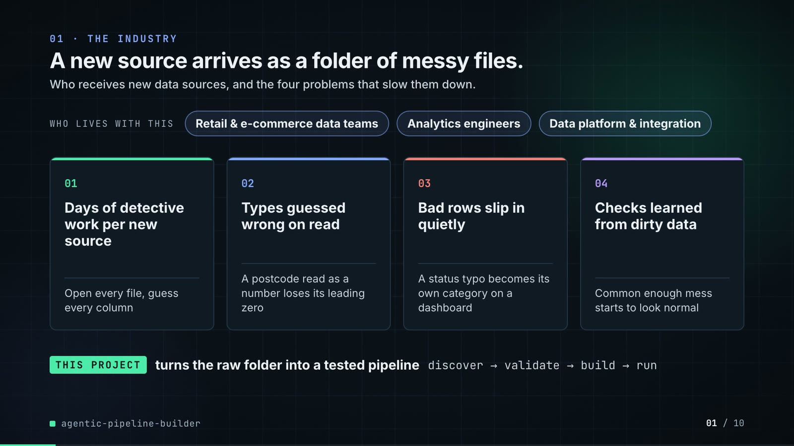

**On-screen text (verbatim)**

> 01 · THE INDUSTRY  
> A new source arrives as a folder of messy files.  
> Who receives new data sources, and the four problems that slow them down.  
> WHO LIVES WITH THIS · Retail & e-commerce data teams · Analytics engineers · Data platform & integration  
> 01 Days of detective work per new source — Open every file, guess every column  
> 02 Types guessed wrong on read — A postcode read as a number loses its leading zero  
> 03 Bad rows slip in quietly — A status typo becomes its own category on a dashboard  
> 04 Checks learned from dirty data — Common enough mess starts to look normal  
> THIS PROJECT turns the raw folder into a tested pipeline · discover → validate → build → run  

**Figures on this slide**

| ID | Shown | Source · key | Calculation | Check |
|---|---|---|---|---|
| F-01 | 3 chips | `author's framing` · - | - | manual |
| F-02 | 4 problem cards | `README 'The problem', 'Why it is hard'` · README lines 16-34 | - | ✓ |

**Assumptions:** A-13

**Illustrative, not data:**

- The whole slide is context; no repo figures.

**To change this slide:** Edit the chips (#ctx-c1..3), cards (#ctx-k1..4) and subtitle (#ctx-sub) in compositions/s01-context.html. (project folder `docs/demo/source`).

### Slide 02: This project  
*6.8-12.0 s · composition `compositions/s02-hook.html`*

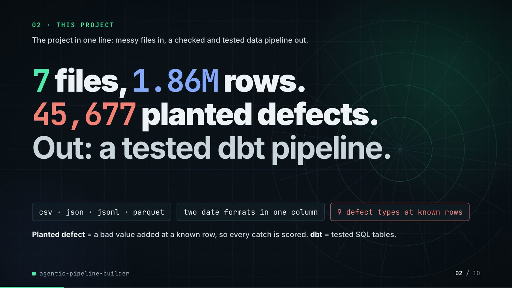

**On-screen text (verbatim)**

> 02 · THIS PROJECT  
> The project in one line: messy files in, a checked and tested data pipeline out.  
> 7 files, 1.86M rows. 45,677 planted defects. Out: a tested dbt pipeline.  
> csv · json · jsonl · parquet · two date formats in one column · 9 defect types at known rows  
> Planted defect = a bad value added at a known row, so every catch is scored. dbt = tested SQL tables.  

**Figures on this slide**

| ID | Shown | Source · key | Calculation | Check |
|---|---|---|---|---|
| F-03 | 7 files | `examples/catalog.yml` · tables | count of tables | ✓ |
| F-04 | 1.86M rows | `outputs/metrics.json` · quarantine[*].rows | 60,300 + 972,645 + 402,000 + 405,134 + 4,000 + 19,575 + 120 = 1,863,774 | ✓ |
| F-05 | 45,677 planted defects | `outputs/metrics.json` · dq.agent.injected | - | ✓ |
| F-06 | csv · json · jsonl · parquet | `examples/catalog.yml` · tables[*].file extensions | set of extensions | ✓ |
| F-07 | two date formats in one column | `examples/catalog.yml` · customers.signup_date formats ['%m/%d/%Y', '%Y-%m-%d'] | - | ✓ |
| F-08 | 9 defect types at known rows | `outputs/metrics.json` · dq.agent.by_defect | count of keys | ✓ |

**Assumptions:** A-01, A-02, A-12

**Illustrative, not data:**

- Rings in the background are decoration.

**To change this slide:** Headline spans #hook-l1..l3, chips #hook-f1..f3 and the definition line #hook-def in compositions/s02-hook.html; sizes come from make e2e (outputs/metrics.json). (project folder `docs/demo/source`).

### Slide 03: How it works (white chapter, slide A)  
*11.7-19.7 s · composition `compositions/explainer.html (CONFIG.blocks, CONFIG.groups, CONFIG.loop)`*

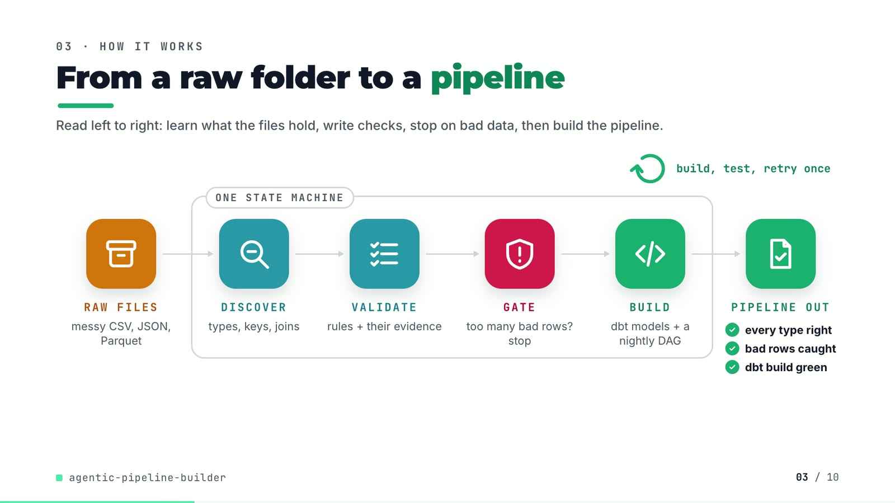

**On-screen text (verbatim)**

> 03 · HOW IT WORKS  
> From a raw folder to a pipeline  
> Read left to right: learn what the files hold, write checks, stop on bad data, then build the pipeline.  
> RAW FILES messy CSV, JSON, Parquet → [ONE STATE MACHINE: DISCOVER types, keys, joins → VALIDATE rules + their evidence → GATE too many bad rows? stop → BUILD dbt models + a nightly DAG] → PIPELINE OUT ✓ every type right ✓ bad rows caught ✓ dbt build green  
> build, test, retry once (loop over BUILD)  

**Figures on this slide**

| ID | Shown | Source · key | Calculation | Check |
|---|---|---|---|---|
| F-09 | ONE STATE MACHINE / orchestrator.py band | `src/pipeline_builder/orchestrator.py:131-148` · STATES, TRANSITIONS | - | ✓ |
| F-10 | too many bad rows? stop / quarantine > 5%? any table / HALTED | `src/pipeline_builder/orchestrator.py:35, :93-95, :143` · max_quarantine_rate = 0.05; too_many_rejects -> HALTED | - | ✓ |
| F-11 | build, test, retry once / retried once | `src/pipeline_builder/orchestrator.py:153` · MAX_ATTEMPTS DBT_BUILD = 2 | 2 attempts = 1 retry | ✓ |
| F-12 | every type right / bad rows caught / dbt build green | `outputs/metrics.json` · schema.types.agent, quarantine, dbt | agent types correct == total; quarantined rows > 0; dbt.ok and no failed tests | ✓ |
| F-47 | 100% (54/54) | `outputs/metrics.json` · schema.types.agent.accuracy | - | ✓ |

**Assumptions:** A-04, A-06

**Illustrative, not data:**

- Icons and colours are a visual language, not data.

**To change this slide:** Edit CONFIG and #ex-a-sub in compositions/explainer.html; badge truth is F-12. (project folder `docs/demo/source`).

### Slide 04: The key idea (white chapter, slide B)  
*19.7-26.7 s · composition `compositions/explainer.html (#ex-b ...)`*

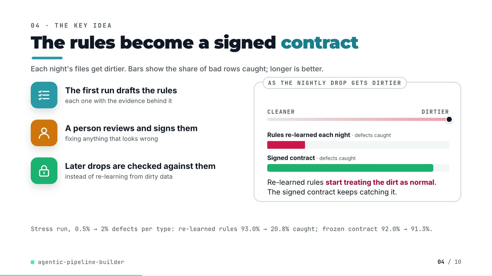

**On-screen text (verbatim)**

> 04 · THE KEY IDEA  
> The rules become a signed contract  
> Each night's files get dirtier. Bars show the share of bad rows caught; longer is better.  
> The first run drafts the rules — each one with the evidence behind it  
> A person reviews and signs them — fixing anything that looks wrong  
> Later drops are checked against them — instead of re-learning from dirty data  
> AS THE NIGHTLY DROP GETS DIRTIER: CLEANER → DIRTIER; Rules re-learned each night · defects caught (red bar shrinks); Signed contract · defects caught (green bar holds). Re-learned rules start treating the dirt as normal. The signed contract keeps catching it.  
> Stress run, 0.5% → 2% defects per type: re-learned rules 93.0% → 20.8% caught; frozen contract 92.0% → 91.3%.  

**Figures on this slide**

| ID | Shown | Source · key | Calculation | Check |
|---|---|---|---|---|
| F-13 | 93.0% | `outputs/stress.json` · sweep['0.005'].dq_recall | - | ✓ |
| F-14 | 20.8% | `outputs/stress.json` · sweep['0.02'].dq_recall | - | ✓ |
| F-15 | 92.0% | `outputs/stress.json` · frozen_contract['0.005'].dq_recall | - | ✓ |
| F-16 | 91.3% (slide 09 panel and payoff strip) | `outputs/stress.json` · frozen_contract['0.02'].dq_recall | - | ✓ |
| F-17 | red bar 0.9300 -> 0.2075, green bar 0.9197 -> 0.9126 of full width | `demo:compositions/explainer.html; outputs/stress.json` · scaleX targets | scaleX = recall (4 decimals, as stored) | ✓ |

**Assumptions:** A-05, A-08, A-09

**Illustrative, not data:**

- The slider is schematic (cleaner → dirtier = 0.5% → 2%); bar lengths are the stress recalls (F-17).

**To change this slide:** Markup under #ex-b in compositions/explainer.html; the footnote figures are F-13..F-16. (project folder `docs/demo/source`).

### Slide 05: Architecture  
*26.4-41.0 s · composition `compositions/s03-architecture.html`*

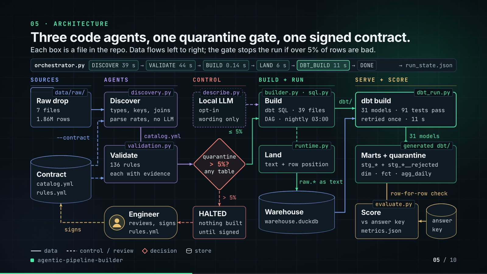

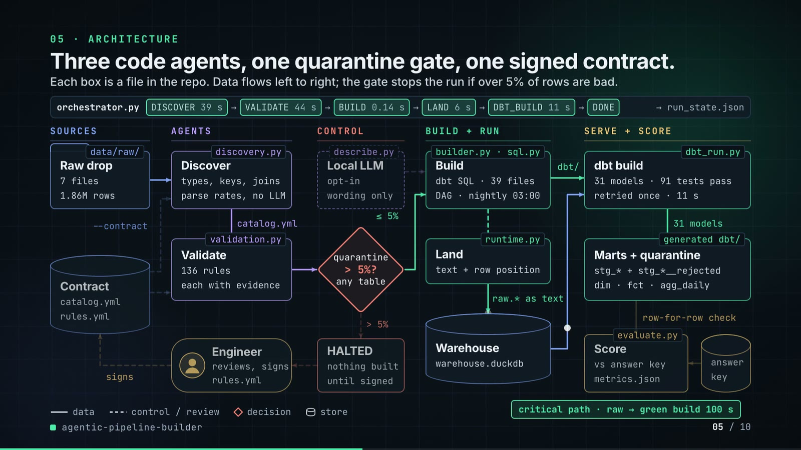

**On-screen text (verbatim)**

> 05 · ARCHITECTURE  
> Three code agents, one quarantine gate, one signed contract.  
> Each box is a file in the repo. Data flows left to right; the gate stops the run if over 5% of rows are bad.  
> orchestrator.py: DISCOVER 39 s → VALIDATE 44 s → BUILD 0.14 s → LAND 6 s → DBT_BUILD 11 s → DONE → run_state.json  
> SOURCES: data/raw/ Raw drop (7 files, 1.86M rows) · Contract store (catalog.yml, rules.yml) --contract → Discover, Validate  
> AGENTS: discovery.py Discover (types, keys, joins; parse rates, no LLM) → catalog.yml → validation.py Validate (136 rules, each with evidence) · Engineer (reviews, signs rules.yml) → signs → Contract  
> CONTROL: describe.py Local LLM (opt-in, wording only; dashed = external) · quarantine > 5%? any table (≤ 5% → Build; > 5% → HALTED: nothing built until signed → Engineer)  
> BUILD + RUN: builder.py · sql.py Build (dbt SQL · 39 files, DAG · nightly 03:00) → runtime.py Land (text + row position) → raw.* as text → Warehouse (warehouse.duckdb)  
> SERVE + SCORE: dbt_run.py dbt build (31 models · 91 tests pass, retried once · 11 s) → 31 models → generated dbt/ Marts + quarantine (stg_* + stg_*__rejected; dim · fct · agg_daily) → row-for-row check → evaluate.py Score (vs answer key, metrics.json) ← answer key  
> Legend: data · control / review · decision · store. Critical path · raw → green build 100 s  

**Figures on this slide**

| ID | Shown | Source · key | Calculation | Check |
|---|---|---|---|---|
| F-03 | 7 files | `examples/catalog.yml` · tables | count of tables | ✓ |
| F-04 | 1.86M rows | `outputs/metrics.json` · quarantine[*].rows | 60,300 + 972,645 + 402,000 + 405,134 + 4,000 + 19,575 + 120 = 1,863,774 | ✓ |
| F-09 | ONE STATE MACHINE / orchestrator.py band | `src/pipeline_builder/orchestrator.py:131-148` · STATES, TRANSITIONS | - | ✓ |
| F-10 | too many bad rows? stop / quarantine > 5%? any table / HALTED | `src/pipeline_builder/orchestrator.py:35, :93-95, :143` · max_quarantine_rate = 0.05; too_many_rejects -> HALTED | - | ✓ |
| F-11 | build, test, retry once / retried once | `src/pipeline_builder/orchestrator.py:153` · MAX_ATTEMPTS DBT_BUILD = 2 | 2 attempts = 1 retry | ✓ |
| F-18 | 39 s · 44 s · 0.14 s · 6 s · 11 s | `outputs/metrics.json` · state_log[*].seconds (DISCOVER..DBT_BUILD) | 38.67, 44.15, 0.14, 5.93, 10.99 rounded (BUILD kept to 2 decimals) | ✓ |
| F-19 | 100 s (slides 05, 06 title, 08) / 99.9 s (slide 06 log) | `outputs/metrics.json` · seconds_raw_to_built = 99.9 | rounded to whole seconds | ✓ |
| F-20 | 136 rules | `outputs/metrics.json; examples/rules.yml` · rules | - | ✓ |
| F-21 | 39 files / 39 dbt files | `outputs/metrics.json` · generated.dbt_files | - | ✓ |
| F-22 | DAG · nightly 03:00 | `examples/raw_drop_pipeline.py:25` · schedule='0 3 * * *' | - | ✓ |
| F-23 | 31 models | `outputs/metrics.json` · dbt.models.success | - | ✓ |
| F-24 | 91 tests pass | `outputs/metrics.json` · dbt.tests.pass | - | ✓ |
| F-25 | file tags on the boxes | `src/pipeline_builder/*.py; README` · orchestrator, discovery, validation, describe, builder, sql, runtime, dbt_run, evaluate | - | ✓ |
| F-26 | --contract into Discover and Validate | `src/pipeline_builder/orchestrator.py:69-90` · cfg.contract -> catalog.yml, rules.yml | - | ✓ |
| F-27 | row-for-row check | `outputs/metrics.json` · sql_vs_pandas[*].only_sql, only_pandas | all zero | ✓ |
| F-28 | Local LLM · opt-in · wording only | `src/pipeline_builder/describe.py:1-7, :24-27; cli.py:203` · ollama_client, --llm default None | - | ✓ |

**Assumptions:** A-04, A-05, A-06, A-07, A-11

**Illustrative, not data:**

- Packets moving along the wires and the state chips lighting up show execution order, not timing; the real durations are the labels in the band.
- In phase B the off-path boxes dim to 75% opacity (still readable) to spotlight the critical path.

**To change this slide:** NODES and W (wires) in compositions/s03-architecture.html; the band chips are static text. (project folder `docs/demo/source`).

### Slide 06: The system running  
*40.6-54.6 s · composition `compositions/s04-routes.html`*

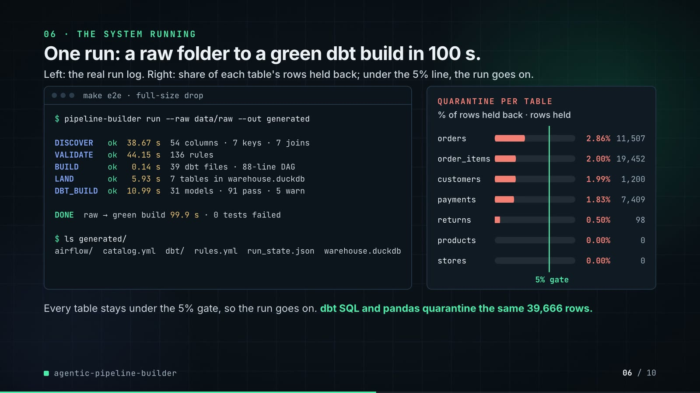

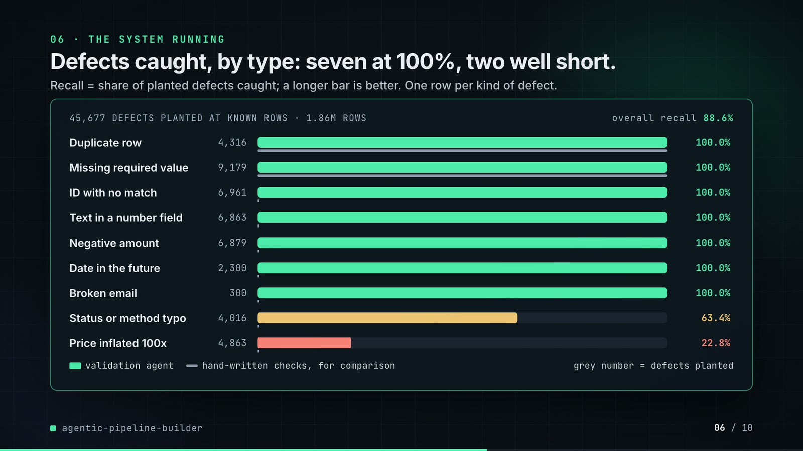

**On-screen text (verbatim)**

> 06 · THE SYSTEM RUNNING  
> One run: a raw folder to a green dbt build in 100 s.  
> Left: the real run log. Right: share of each table's rows held back; under the 5% line, the run goes on.  
> $ pipeline-builder run --raw data/raw --out generated · DISCOVER ok 38.67 s 54 columns · 7 keys · 7 joins · VALIDATE ok 44.15 s 136 rules · BUILD ok 0.14 s 39 dbt files · 88-line DAG · LAND ok 5.93 s 7 tables in warehouse.duckdb · DBT_BUILD ok 10.99 s 31 models · 91 pass · 5 warn · DONE raw → green build 99.9 s · 0 tests failed  
> QUARANTINE PER TABLE (% of rows held back · rows held): orders 2.86% 11,507 · order_items 2.00% 19,452 · customers 1.99% 1,200 · payments 1.83% 7,409 · returns 0.50% 98 · products 0.00% 0 · stores 0.00% 0 · 5% gate  
> Every table stays under the 5% gate, so the run goes on. dbt SQL and pandas quarantine the same 39,666 rows.  
> Phase 2: Defects caught, by type: seven at 100%, two well short. Recall = share of planted defects caught; a longer bar is better. One row per kind of defect.  
> 45,677 DEFECTS PLANTED AT KNOWN ROWS · 1.86M ROWS · overall recall 88.6% · Duplicate row · Missing required value · ID with no match · Text in a number field · Negative amount · Date in the future · Broken email (all 100.0%) · Status or method typo 63.4% · Price inflated 100x 22.8% (F-36); key: validation agent · hand-written checks, for comparison (F-38) · grey number = defects planted  

**Figures on this slide**

| ID | Shown | Source · key | Calculation | Check |
|---|---|---|---|---|
| F-04 | 1.86M rows | `outputs/metrics.json` · quarantine[*].rows | 60,300 + 972,645 + 402,000 + 405,134 + 4,000 + 19,575 + 120 = 1,863,774 | ✓ |
| F-05 | 45,677 planted defects | `outputs/metrics.json` · dq.agent.injected | - | ✓ |
| F-19 | 100 s (slides 05, 06 title, 08) / 99.9 s (slide 06 log) | `outputs/metrics.json` · seconds_raw_to_built = 99.9 | rounded to whole seconds | ✓ |
| F-20 | 136 rules | `outputs/metrics.json; examples/rules.yml` · rules | - | ✓ |
| F-21 | 39 files / 39 dbt files | `outputs/metrics.json` · generated.dbt_files | - | ✓ |
| F-23 | 31 models | `outputs/metrics.json` · dbt.models.success | - | ✓ |
| F-24 | 91 tests pass | `outputs/metrics.json` · dbt.tests.pass | - | ✓ |
| F-27 | row-for-row check | `outputs/metrics.json` · sql_vs_pandas[*].only_sql, only_pandas | all zero | ✓ |
| F-29 | 54 columns · 7 keys · 7 joins | `outputs/metrics.json` · schema.types.agent.total, primary_keys.correct, foreign_keys.found | - | ✓ |
| F-30 | 38.67 · 44.15 · 0.14 · 5.93 · 10.99 | `outputs/metrics.json` · state_log[*].seconds | - | ✓ |
| F-31 | 88-line DAG | `outputs/metrics.json` · generated.dag_lines | - | ✓ |
| F-32 | 5 warn | `outputs/metrics.json` · dbt.tests.warn | - | ✓ |
| F-33 | DONE · 0 tests failed | `outputs/metrics.json` · final_state, dbt.failed | - | ✓ |
| F-34 | orders 2.86% 11,507 · order_items 2.00% 19,452 · customers 1.99% 1,200 · payments 1.83% 7,409 · returns 0.50% 98 · products 0.00% 0 · stores 0.00% 0 | `outputs/metrics.json` · quarantine[*] | quarantine_rate x 100 to 2 decimals | ✓ |
| F-35 | the same 39,666 rows | `outputs/metrics.json` · sql_vs_pandas[*].both | 1,200 + 19,452 + 11,507 + 7,409 + 98 = 39,666 (sql = pandas = both) | ✓ |
| F-36 | 9 bars with plain names | `outputs/metrics.json; src/pipeline_builder/datagen.py:515-569` · dq.agent.by_defect | on-screen names: duplicate_row = Duplicate row, null_required = Missing required value, orphan_fk = ID with no match, type_corruption = Text in a number field, negative_value = Negative amount, future_date = Date in the future, malformed_email = Broken email, invalid_enum = Status or method typo (orders.status, payments.method), outlier_value = Price inflated 100x (order_items.unit_price x 100) | ✓ |
| F-37 | 88.6% | `outputs/metrics.json` · dq.agent.recall = 0.8856 | - | ✓ |
| F-38 | 100% for Duplicate row and Missing required value, 0% for the other seven | `outputs/metrics.json` · dq.naive_baseline.by_defect | - | ✓ |
| F-44 | under the 5% gate | `outputs/metrics.json` · max quarantine_rate = 0.02862 | max rate < 0.05 | ✓ |

**Assumptions:** A-02, A-03, A-04, A-07, A-09, A-10

**Illustrative, not data:**

- The terminal is a styled rendering of the state log in outputs/metrics.json, not a screen recording; the command line is the one make e2e runs (without its report flags).
- Defect names are plain-English labels for the generator's defect keys (mapping in F-36).

**To change this slide:** LOG, Q, DQ and PLAIN in compositions/s04-routes.html (numbers copied from outputs/metrics.json). (project folder `docs/demo/source`).

### Slide 07: End-user value (white)  
*54.3-67.3 s · composition `compositions/value.html (SHEET injected by tools/inject_contract.py; CONFIG)`*

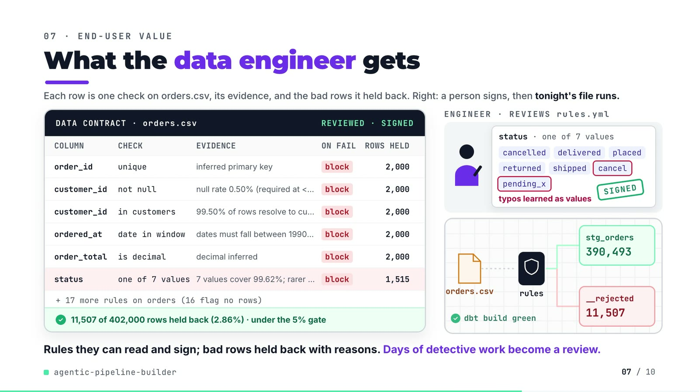

**On-screen text (verbatim)**

> 07 · END-USER VALUE  
> What the data engineer gets  
> Each row is one check on orders.csv, its evidence, and the bad rows it held back. Right: a person signs, then tonight's file runs.  
> DATA CONTRACT · orders.csv · DRAFT → REVIEWED · SIGNED  
> COLUMN / CHECK / EVIDENCE / ON FAIL / ROWS HELD: order_id unique (inferred primary key) block 2,000 · customer_id not null (null rate 0.50% (required at <= 1%)) block 2,000 · customer_id in customers (99.50% of rows resolve to customers.customer_id) block 2,000 · ordered_at date in window (dates must fall between 1990-01-01 and the run date 2026-02-01) block 2,000 · order_total is decimal (decimal inferred) block 2,000 · status one of 7 values (7 values cover 99.62%; rarer values excluded) block 1,515  
> + 17 more rules on orders (16 flag no rows)  
> 11,507 of 402,000 rows held back (2.86%) · under the 5% gate  
> Scene: ENGINEER · REVIEWS rules.yml — status · one of 7 values: cancelled, delivered, placed, returned, shipped, cancel (ringed), pending_x (ringed) · typos learned as values · SIGNED stamp  
> TONIGHT'S DROP: orders.csv → rules → stg_orders 390,493 / __rejected 11,507 · dbt build green  
> Rules they can read and sign; bad rows held back with reasons. Days of detective work become a review.  

**Figures on this slide**

| ID | Shown | Source · key | Calculation | Check |
|---|---|---|---|---|
| F-39 | order_id unique 2,000 · customer_id not null 2,000 · customer_id in customers 2,000 · ordered_at date in window 2,000 · order_total is decimal 2,000 · status one of 7 values 1,515 | `demo:assets/contract_sheet.json (tools/export_contract_sheet.py re-runs discovery + validation on data/raw); examples/rules.yml` · rules[*].rows_flagged, evidence, severity | rows held per rule = unique rows the rule flags | ✓ |
| F-40 | 11,507 of 402,000 rows held back (2.86%) | `outputs/metrics.json` · quarantine[table=orders] | 11,507 / 402,000 = 2.86% | ✓ |
| F-41 | stg_orders 390,493 | `outputs/metrics.json` · orders rows - quarantined; marts.fct_orders | 402,000 - 11,507 = 390,493 (equals the fct_orders row count) | ✓ |
| F-42 | + 17 more rules on orders (16 flag no rows) | `examples/rules.yml; demo:assets/contract_sheet.json` · orders rules = 23 | 23 - 6 shown = 17; 16 of them flag 0 rows (the order_total outlier warning flags 17) | ✓ |
| F-43 | cancel, pending_x ringed in the status value set | `examples/rules.yml orders__status__in_set; README 'Known limitations'` · kwargs.value_set | - | ✓ |
| F-44 | under the 5% gate | `outputs/metrics.json` · max quarantine_rate = 0.02862 | max rate < 0.05 | ✓ |
| F-45 | Days of detective work become a review. | `README 'The problem' (days per source) and 'Known limitations' (first contract needs a person)` · - | - | ✓ |

**Assumptions:** A-03, A-04, A-14

**Illustrative, not data:**

- Row tokens flowing to the bins are schematic (every 11th to quarantine); the counters are real.
- The review (ringing two values, the SIGNED stamp) shows the human step the README asks for; the counts shown are from the draft run, before any edit.
- Long evidence strings are cut with an ellipsis on screen; the full text is in examples/rules.yml.

**To change this slide:** Re-run tools/export_contract_sheet.py, then tools/inject_contract.py with --rules; scene layout in CONFIG of compositions/value.html. (project folder `docs/demo/source`).

### Slide 08: Results  
*67.0-75.8 s · composition `compositions/s05-results.html`*

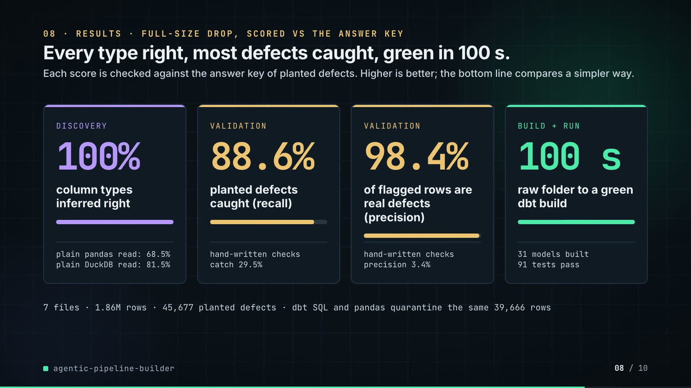

**On-screen text (verbatim)**

> 08 · RESULTS · FULL-SIZE DROP, SCORED VS THE ANSWER KEY  
> Every type right, most defects caught, green in 100 s.  
> Each score is checked against the answer key of planted defects. Higher is better; the bottom line compares a simpler way.  
> DISCOVERY 100% column types inferred right · plain pandas read: 68.5% · plain DuckDB read: 81.5%  
> VALIDATION 88.6% planted defects caught (recall) · hand-written checks catch 29.5%  
> VALIDATION 98.4% of flagged rows are real defects (precision) · hand-written checks precision 3.4%  
> BUILD + RUN 100 s raw folder to a green dbt build · 31 models built · 91 tests pass  
> 7 files · 1.86M rows · 45,677 planted defects · dbt SQL and pandas quarantine the same 39,666 rows  

**Figures on this slide**

| ID | Shown | Source · key | Calculation | Check |
|---|---|---|---|---|
| F-03 | 7 files | `examples/catalog.yml` · tables | count of tables | ✓ |
| F-04 | 1.86M rows | `outputs/metrics.json` · quarantine[*].rows | 60,300 + 972,645 + 402,000 + 405,134 + 4,000 + 19,575 + 120 = 1,863,774 | ✓ |
| F-05 | 45,677 planted defects | `outputs/metrics.json` · dq.agent.injected | - | ✓ |
| F-19 | 100 s (slides 05, 06 title, 08) / 99.9 s (slide 06 log) | `outputs/metrics.json` · seconds_raw_to_built = 99.9 | rounded to whole seconds | ✓ |
| F-23 | 31 models | `outputs/metrics.json` · dbt.models.success | - | ✓ |
| F-24 | 91 tests pass | `outputs/metrics.json` · dbt.tests.pass | - | ✓ |
| F-35 | the same 39,666 rows | `outputs/metrics.json` · sql_vs_pandas[*].both | 1,200 + 19,452 + 11,507 + 7,409 + 98 = 39,666 (sql = pandas = both) | ✓ |
| F-37 | 88.6% | `outputs/metrics.json` · dq.agent.recall = 0.8856 | - | ✓ |
| F-47 | 100% (54/54) | `outputs/metrics.json` · schema.types.agent.accuracy | - | ✓ |
| F-48 | plain pandas read: 68.5% / plain DuckDB read: 81.5% | `outputs/metrics.json` · schema.types.pandas_default / duckdb_sniff accuracy | - | ✓ |
| F-50 | hand-written checks / catch 29.5% | `outputs/metrics.json` · dq.naive_baseline.recall | - | ✓ |
| F-51 | 98.4% | `outputs/metrics.json` · dq.agent.row_precision | - | ✓ |
| F-52 | hand-written checks / precision 3.4% | `outputs/metrics.json` · dq.naive_baseline.row_precision | - | ✓ |

**Assumptions:** A-01, A-07, A-09, A-10, A-12

**Illustrative, not data:**

- The mini bars under each number are the number as a share of 100%; the 100 s card's bar is full by design.

**To change this slide:** The stats array and card text in compositions/s05-results.html. (project folder `docs/demo/source`).

### Slide 09: Lesson and fix  
*75.4-84.4 s · composition `compositions/s06-twist.html`*

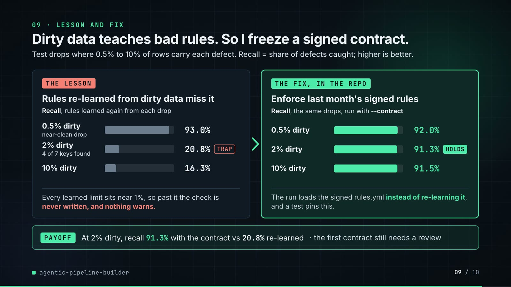

**On-screen text (verbatim)**

> 09 · LESSON AND FIX  
> Dirty data teaches bad rules. So I freeze a signed contract.  
> Test drops where 0.5% to 10% of rows carry each defect. Recall = share of defects caught; higher is better.  
> THE LESSON — Rules re-learned from dirty data miss it. Recall, rules learned again from each drop: 0.5% dirty (near-clean drop) 93.0% · 2% dirty (4 of 7 keys found) 20.8% TRAP · 10% dirty 16.3%  
> Every learned limit sits near 1%, so past it the check is never written, and nothing warns.  
> THE FIX, IN THE REPO — Enforce last month's signed rules. Recall, the same drops, run with --contract: 0.5% dirty 92.0% · 2% dirty 91.3% HOLDS · 10% dirty 91.5%  
> The run loads the signed rules.yml instead of re-learning it, and a test pins this.  
> PAYOFF — At 2% dirty, recall 91.3% with the contract vs 20.8% re-learned · the first contract still needs a review  

**Figures on this slide**

| ID | Shown | Source · key | Calculation | Check |
|---|---|---|---|---|
| F-13 | 93.0% | `outputs/stress.json` · sweep['0.005'].dq_recall | - | ✓ |
| F-14 | 20.8% | `outputs/stress.json` · sweep['0.02'].dq_recall | - | ✓ |
| F-15 | 92.0% | `outputs/stress.json` · frozen_contract['0.005'].dq_recall | - | ✓ |
| F-16 | 91.3% (slide 09 panel and payoff strip) | `outputs/stress.json` · frozen_contract['0.02'].dq_recall | - | ✓ |
| F-58 | 16.3% | `outputs/stress.json` · sweep['0.1'].dq_recall | - | ✓ |
| F-59 | 91.5% | `outputs/stress.json` · frozen_contract['0.1'].dq_recall | - | ✓ |
| F-60 | 2% dirty · 4 of 7 keys found | `outputs/stress.json` · sweep['0.02'].primary_keys | - | ✓ |
| F-61 | Every learned limit sits near 1%, so past it the check is never written, and nothing warns. | `src/pipeline_builder/discovery.py:30-31; validation.py:25, :31` · KEY_MAX_NULL 0.01, KEY_MIN_DISTINCT 0.99, NOT_NULL_MAX 0.01, NON_NEGATIVE_SHARE 0.99 | - | ✓ |
| F-67 | Enforce last month's signed rules / run with --contract / The run loads the signed rules.yml instead of re-learning it, and a test pins this. | `src/pipeline_builder/orchestrator.py:39-41, :69-90; cli.py:206; tests/test_pipeline.py:125-142` · RunConfig.contract; discover_state, validate_state; test_frozen_contract_still_catches_defects_on_a_much_dirtier_drop | - | ✓ |
| F-68 | 242 · 54 · 42 · 239 · 237 · 238 px | `demo:compositions/s06-twist.html; outputs/stress.json` · #twist-lb1..3, #twist-rb1..3 widths | round(recall x 260) | ✓ |
| F-69 | 0.5% to 10% of rows carry each defect; rows 0.5% · 2% · 10% dirty | `outputs/stress.json` · sweep keys, frozen_contract keys | - | ✓ |

**Assumptions:** A-05, A-08, A-09

**Illustrative, not data:**

- Both panels share one bar scale: 100% recall = 260 px (F-68).
- Left bars are neutral grey (coral only on the TRAP label and lesson tag); right bars are mint because they are the fix the code implements.

**To change this slide:** Rows #twist-l1..l3 / #twist-r1..r3 and the payoff strip in compositions/s06-twist.html (values from outputs/stress.json via make stress). (project folder `docs/demo/source`).

### Slide 10: End card  
*84.0-88.4 s · composition `compositions/s07-end.html`*

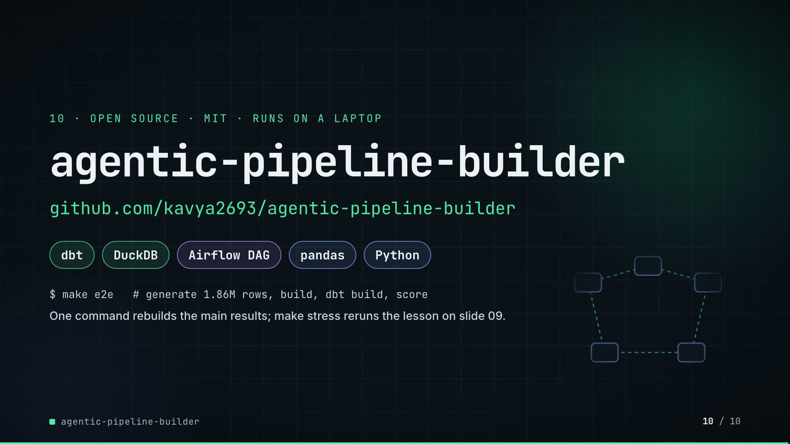

**On-screen text (verbatim)**

> 10 · OPEN SOURCE · MIT · RUNS ON A LAPTOP  
> agentic-pipeline-builder  
> github.com/kavya2693/agentic-pipeline-builder  
> dbt · DuckDB · Airflow DAG · pandas · Python  
> $ make e2e   # generate 1.86M rows, build, dbt build, score  
> One command rebuilds the main results; make stress reruns the lesson on slide 09.  

**Figures on this slide**

| ID | Shown | Source · key | Calculation | Check |
|---|---|---|---|---|
| F-70 | make stress reruns the lesson on slide 09 | `Makefile` · stress: scripts/stress_defect_rate.py | - | ✓ |
| F-63 | OPEN SOURCE · MIT | `LICENSE` · - | - | ✓ |
| F-64 | dbt · DuckDB · Airflow DAG · pandas · Python | `pyproject.toml; examples/raw_drop_pipeline.py` · dependencies; airflow import | - | ✓ |
| F-65 | $ make e2e   # generate 1.86M rows, build, dbt build, score | `Makefile` · e2e: data run | - | ✓ |
| F-66 | RUNS ON A LAPTOP | `README 'The result'` · 'green build in 100 s on a laptop' | - | ✓ |

**Assumptions:** A-12

**Illustrative, not data:**

- The faint five-node loop on the right is decoration (a state-machine motif).

**To change this slide:** Text in compositions/s07-end.html. (project folder `docs/demo/source`).

## 5. Change-impact matrix

| Input / assumption | Affected figures | Affected slides | Files to edit | Commands to re-run |
|---|---|---|---|---|
| A-01: All data is synthetic: a seeded generator writes a regional retailer's nightly drop (60k customers, 400k orders, 973k order lines, 405k payments, 20k returns, 4,000 products, 120 stores) | all figures | 01, 02, 03, 04, 05, 06, 07, 08, 09, 10 | `src/pipeline_builder/datagen.py; scripts/generate_data.py` | `make e2e; make stress` |
| A-02: Defects are planted at 0 | F-05, F-08, F-36, F-37, F-38, F-50, F-51, F-52 | 02, 06, 08 | `scripts/generate_data.py:15` | `make e2e` |
| A-03: The drop is judged as of 2026-02-01: date-window rules reject dates after the run date | F-34, F-36, F-39, F-40 | 06, 07 | `Makefile:4` | `make e2e; export_contract_sheet.py + inject_contract.py` |
| A-04: Quarantine gate: the run halts before building if any table would quarantine more than 5% of its rows | F-10, F-34, F-44 | 03, 05, 06, 07 | `src/pipeline_builder/orchestrator.py:35 or --max-quarantine-rate` | `make e2e` |
| A-05: Profiler tolerances sit near 1%: a type needs 98% of values to parse, a required column at most 1% nulls, a key 99% distinct and at most 1% nulls, a non-negative column 99% non-negative, a category at least 0 | F-03, F-20, F-29, F-36, F-47, F-13, F-14, F-58, F-61 | 02, 03, 04, 05, 06, 08, 09 | `src/pipeline_builder/discovery.py:27-35; src/pipeline_builder/validation.py:25-36` | `make e2e; make stress` |
| A-06: Retry policy: only DBT_BUILD and LAND are retried (2 attempts each); a rule that fails on the data fails the same way twice | F-11 | 03, 05 | `src/pipeline_builder/orchestrator.py:153` | `make e2e` |
| A-07: Timings are wall-clock seconds from one run on the author's laptop and vary with the machine and its load | F-18, F-19, F-30 | 05, 06, 08 | `-` | `make e2e` |
| A-08: Stress runs are at 10% scale (about 40,000 orders) with defect rates 0 | F-13, F-14, F-15, F-16, F-17, F-58, F-59, F-60, F-68, F-69 | 04, 09 | `scripts/stress_defect_rate.py:93-103` | `make stress` |
| A-09: Scoring: a defect is caught when a rule flags its row on its column (a duplicate row by any uniqueness rule) | F-36, F-37, F-38, F-50, F-51, F-52, F-13, F-14, F-15, F-16, F-58, F-59, F-68 | 04, 06, 08, 09 | `src/pipeline_builder/evaluate.py:143` | `make e2e; make stress` |
| A-10: The 'hand-written first pass' baseline is every column required plus the first column unique | F-38, F-50, F-52 | 06, 08 | `src/pipeline_builder/validation.py:276` | `make e2e` |
| A-11: The local LLM (Ollama) is off by default and only words column descriptions; types, keys, rules and SQL are deterministic code | F-28 | 05 | `--llm flag` | `uv run pipeline-builder run ... --llm llama3.2` |
| A-12: Video rounding: percentages to 1 decimal (the type-accuracy card to 0), seconds to whole numbers on slides 05 and 08 (BUILD 0 | F-04, F-18, F-19, F-36, F-37, F-47, F-48, F-50, F-51, F-52 | 02, 03, 05, 06, 08 | `the composition file named on each slide` | `hyperframes render` |
| A-13: Slide 01 (industry, everyday problems) is general data-engineering knowledge used as context, echoed by the README's problem statement | F-01, F-02 | 01 | `compositions/s01-context.html` | `hyperframes render` |
| A-14: Slide 07's scene is schematic: the row tokens are illustrative (every 11th goes to quarantine); the counters, the contract rows and the ringed values come from the export | F-39, F-41, F-43 | 07 | `compositions/value.html (CONFIG)` | `hyperframes render` |

## 6. Known differences and caveats

- All data is synthetic and the generator and inference rules share an author: 100% type accuracy is an upper bound (A-01). The format-shift stress arm (outputs/stress.md) is the honest measure and drops type accuracy to 94.4% without a warning; it is not on screen.
- Slide 04's footnote and slide 09 use the 10%-scale stress runs; slides 02, 06 and 08 use the full-size drop. The two 0.5% recalls differ (93.0% at 10% scale vs 88.6% full size).
- Timings (39/44/0.14/6/11 s, 100 s) are one run on the author's laptop (A-07).
- The Airflow DAG is generated and checked against stub modules, not run on a live Airflow (README 'Known limitations'); the end card's 'Airflow DAG' chip means the generated file.
- Inflated prices are mostly missed (22.8%) and 322 orders with the rare real status 'disputed' are quarantined as typos (README); slide 07's status row (1,515 rows held) includes those 322.
- Slide 07's review step is shown, not measured: the counts on the sheet are from the draft rules, before any edit.
- Slide 09 shows the stress sweep at 0.5%, 2% and 10%; the 5% row (re-learned 16.3%, frozen 91.6%) and the format-shift arm (type accuracy 94.4%, no warning) are dropped from the slide and still reported in outputs/stress.md and the README section 'The run that embarrasses the headline'.
- On slide 09 the near-clean 0.5% drop scores slightly higher with re-learned rules (93.0%) than with the frozen contract (92.0%); both are shown. The fix is not free: the first contract still needs a person to read rules.yml (README 'Known limitations').
- Slide 01 statements are general data-engineering knowledge (A-13).

## Appendix: environment

- Commit: `cbcb816890b0cb816098c9b2e8f9850dc959f944`
- Python: 3.11.7
- pandas 3.0.6
- numpy 2.4.6
- duckdb 1.5.6
- yaml 6.0.3
- pyarrow 26.0.0
- Profile / seeds: data_seed=7, stress_baseline_seed=3, defect_rate=0.005, as_of=2026-02-01
- Run time: metrics.json seconds_raw_to_built = 99.9 s for the pipeline run (data generation not included); the contract-sheet export re-runs discovery + validation in about 40 s
